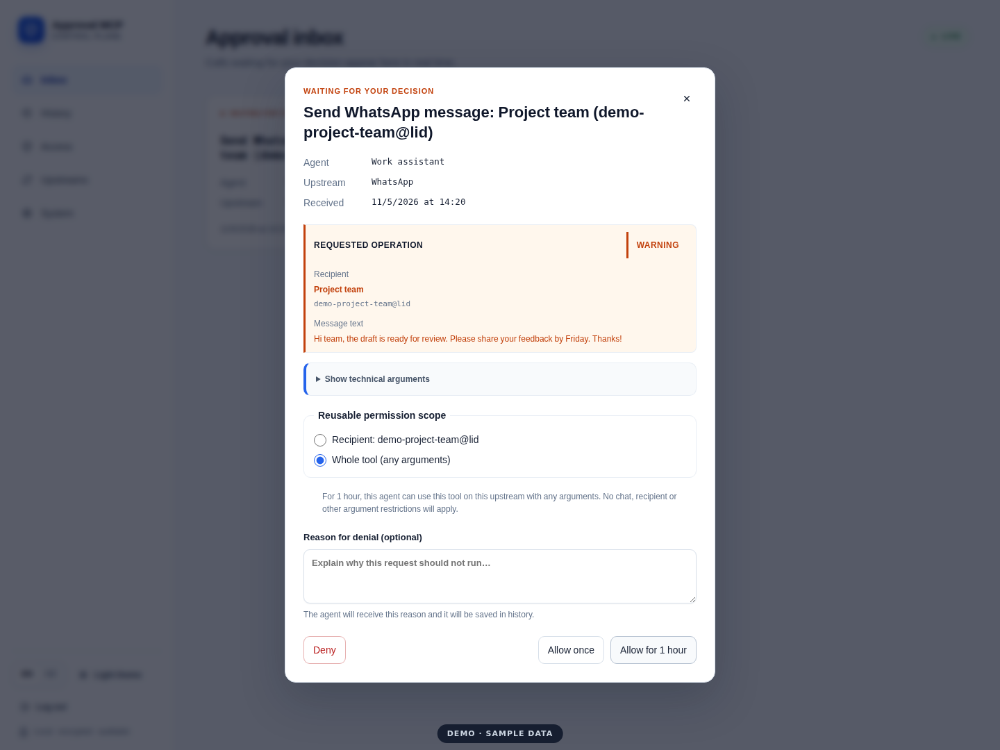

# Approval MCP

An approval gateway between AI agents and your MCP servers. Decide which
tools an agent can use directly, which require human approval, and which are
blocked. Review decisions, active permissions, and call history in the web app.

```text
MCP client → Approval MCP → your MCP servers
                  ↕
           web-based approval
           + push notifications
```

## Demo

[](docs/media/approval-mcp-demo.webm)

[Watch the short demo (WebM)](docs/media/approval-mcp-demo.webm)

The video covers upstreams, profiles, message approval, one-hour tool-wide
permission without recipient restrictions, history, and notification devices.
It uses sample data only: no real WhatsApp messages or push notifications are
sent. [Demo script and recording instructions](docs/demo.md).

## Features

- **Access profiles:** allow, require approval, or deny access to an entire
  upstream or individual tools. Unconfigured tools stay hidden.
- **Readable approvals:** plugins show the message, contact, chat, event, or
  booking involved. Expand the technical arguments when needed.
- **Independent plugins:** install, check for updates, enable, or uninstall
  presentation plugins in **Plugins**. Each has its own Git repository; code
  is cached in the persistent volume, not downloaded on every restart.
- **Temporary permissions:** approve once, approve a specific scope, or allow
  the entire tool with any arguments for one hour. Permanent grants are
  available for supported scopes. Active grants can be revoked at any time.
- **OAuth and passkeys:** the client opens an authorization page where you
  choose an agent name, profile, and access lifetime, then confirm with your
  passkey. Manually created agent tokens are also supported.
- **Web Push:** notifications link to the approval detail. Manage registered
  devices, send individual tests, and remove devices from the web app.
- **History:** call timelines, decisions, denial reasons, and JSONL/CSV export.
- **Live tool catalog:** refresh tools while the server runs, without restarting.
- **English and Czech UI**, light and dark themes, and a mobile layout.

## Docker quick start

You need Docker and a browser with passkey support. For your first local run,
use `http://localhost:43127`. Remote deployments should use HTTPS.

```bash
git clone https://github.com/jiridudekusy/approval-mcp-wrapper.git
cd approval-mcp-wrapper
cp .env.example .env
openssl rand -base64 32
```

Paste the generated key into `.env` as `APPROVAL_MCP_MASTER_KEY`. Keep the
same key for subsequent runs: it encrypts upstream credentials and Web Push
data. Keep `.env` out of Git.

```bash
docker build -t approval-mcp-wrapper:local .
docker volume create approval-mcp-data
docker run -d \
  --name approval-mcp \
  --restart unless-stopped \
  --env-file .env \
  --publish 127.0.0.1:43127:3000 \
  --mount source=approval-mcp-data,target=/data \
  --read-only \
  --tmpfs /tmp:rw,noexec,nosuid,size=64m \
  approval-mcp-wrapper:local
```

Open [localhost:43127](http://localhost:43127) and continue with a passkey.
The first sign-in creates the administrator. Passkeys are bound to the sign-in
hostname, so choose a stable server address for ongoing use.

The `approval-mcp-data` volume and the same master key preserve settings,
active grants, and push device registrations when replacing the image. Keep
the data volume during upgrades. Installed plugins are preserved there too,
under `/data/plugins`; your existing `/data` mount is sufficient. First-time
plugin installation requires outbound HTTPS to `raw.githubusercontent.com`;
update checks also use `api.github.com`. Later restarts use the local cache.
Pending calls are interrupted by a restart.

After a successful CI pipeline, the image is also published as
`ghcr.io/jiridudekusy/approval-mcp-wrapper:latest` for `linux/amd64` and
`linux/arm64`. The registry image may not include unpublished local commits;
the build above uses your current checkout.

## Initial setup

1. In **Upstreams**, add your MCP server's Streamable HTTP URL. Set its alias,
   display name, description, optional credentials, and presentation plugin.
   Metadata can distinguish work and personal email accounts, for example.
2. Select **Discover tools**. Enable private network access when intentionally
   connecting to a local or private network address.
3. Configure rules in **Access → Profiles**. Start with read-only tools and
   use **Require approval** for sensitive operations. Set the approval wait
   timeout and tool execution timeout independently in the same profile;
   both default to 60 seconds.
4. Connect an MCP client through OAuth, or create an agent in **Access** and
   copy its token, which is displayed only once.
5. Calls requiring approval appear in **Inbox** and are recorded in
   **History**. Enable notifications in **System**.

### Connect an MCP client

For OAuth, give your client the HTTP MCP endpoint without a manual token:

```json
{
  "mcpServers": {
    "approval": {
      "type": "http",
      "url": "http://localhost:43127/mcp"
    }
  }
}
```

The exact configuration format depends on the client. During browser
authorization, choose a profile, agent name, and access lifetime. Client
sign-in does not automatically approve individual tool calls.

For a manually created agent, add the HTTP header
`Authorization: Bearer <agent-token>`. Keep the token out of public
configuration files and logs.

`localhost` refers to the client's own machine or container. If your agent
runs elsewhere, use a reachable HTTPS server address and configure the
corresponding OAuth origin. The OAuth callback must be reachable from the
machine running the sign-in browser.
[Multiple addresses and reverse proxies](docs/operations/deployment.md).

### One hour without scope restrictions

In the approval detail, select **Whole tool (any arguments)**, then
**Allow for 1 hour**. The grant applies to the same agent, upstream, and tool,
with no restriction on the chat, recipient, or other arguments. This also
works for plugins that propose no reusable scope. After expiry, approval is
required again. Revoke it earlier in **Access → Active permissions**.

Explicit denies and profile-based tool visibility still apply. This option
does not offer an unrestricted permanent grant.

### Notifications

In **System**, name your device and enable notifications. Send a test to any
registered device or remove it. Clicking a notification opens the request
detail; decisions are made in the authenticated web app.

Use a stable HTTPS address for remote access. On iOS/iPadOS, add the site to
the Home Screen and enable notifications from the installed web app. Push
payloads contain a generic alert, an ID, and a link; tool arguments and
message contents are not included. Notification display and available system
actions depend on the device and browser.

## Run locally without Docker

You need Node.js 24 and npm. Use the same `.env` as in the quick start.

```bash
npm ci
npm run build
mkdir -p .local-data
HOST=127.0.0.1 PORT=43127 \
APPROVAL_MCP_DATA_DIR="$PWD/.local-data" \
node --env-file=.env apps/server/dist/main.js
```

The web app and MCP endpoint share the same port. Run `npm run verify` to
check changes: type checking, tests, production build, runtime dependency
audit, and language catalog validation.

A harmless test upstream is available in
[pocs/approval-test-mcp](pocs/approval-test-mcp/README.md). Its deployment
tool only simulates a deployment.

## Operations and documentation

| Topic | Documentation |
| --- | --- |
| HTTPS, configuration, OAuth origins, persistent data | [Deployment](docs/operations/deployment.md) |
| Backups and data migration | [Backup and restore](docs/operations/backup-and-restore.md) |
| Recovering data after a failure | [Disaster recovery](docs/operations/disaster-recovery.md) |
| Protocol support, OAuth, and built-in MCP tools | [MCP compatibility](docs/operations/mcp-compatibility.md) |
| Presentation plugins and their behavior | [Plugins](docs/operations/approval-plugins.md) |

Health endpoints are `/health/live` and `/health/ready`. The supported
deployment runs one writer over a single data directory. MCP Tasks are not
advertised yet; approval waits in the original tool call.

## Project structure

```text
apps/server       HTTP server, authentication, OAuth, admin API, Web Push
apps/web          React UI
packages/gateway  MCP gateway and approval workflow
packages/policy   rules, profiles, and permission evaluation
packages/*        contracts, state store, audit journal, upstream client, plugin SDK
pocs/             standalone experiments and a test MCP server
```
