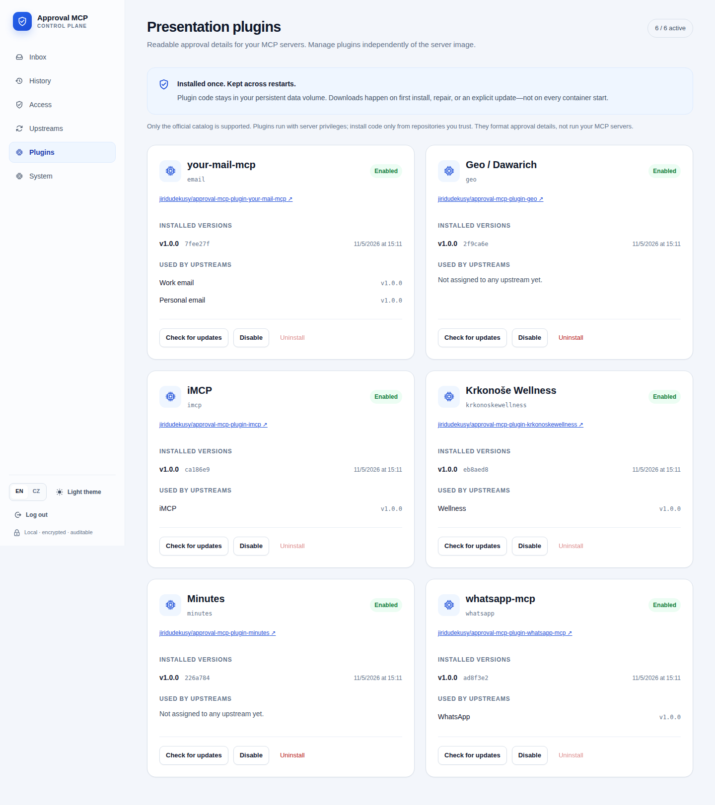

# Approval presentation plugins

Open **Plugins** (`/plugins`) to manage installations, then **Upstreams**, edit an MCP connection, and choose its **Presentation plugin**. The plugin pin is stored on that upstream, so two servers of the same type can use different display names and metadata while sharing the same plugin. Existing connections without a plugin continue to use the generic approval view.

The official catalog contains these independently maintained plugins (not the upstream MCP server implementations):

| Plugin ID | MCP server / repository | Covered tools |
| --- | --- | ---: |
| `email` | [your-mail-mcp](https://github.com/jiridudekusy/approval-mcp-plugin-your-mail-mcp) | 9 |
| `geo` | [geo / Dawarich](https://github.com/jiridudekusy/approval-mcp-plugin-geo) | 8 |
| `imcp` | [iMCP](https://github.com/jiridudekusy/approval-mcp-plugin-imcp) | 27 |
| `krkonoskewellness` | [krkonoskewellness / Reservanto](https://github.com/jiridudekusy/approval-mcp-plugin-krkonoskewellness) | 4 |
| `minutes` | [Minutes / Signal](https://github.com/jiridudekusy/approval-mcp-plugin-minutes) | 35 |
| `whatsapp` | [whatsapp-mcp](https://github.com/jiridudekusy/approval-mcp-plugin-whatsapp-mcp) | 13 |

## Installation and persistence

On the first start after upgrading, the server installs the six catalog plugins
in the background using immutable Git commit pins. Existing plugin IDs,
versions (`1.0.0`), normalization versions, and upstream assignments are preserved.
The generic fallback remains part of the server; it needs no download.

Artifacts live at `/data/plugins/<id>/<revision>/plugin.mjs` in the standard
Docker setup. Installation metadata and enable/disable choices live in the
configuration state in the same `/data` volume. Keep that volume across image
updates: no new mount is required. `APPROVAL_MCP_PLUGINS_DIR` can override the
cache directory; if you do, mount and back up that directory separately.

Restarts verify the local SHA-256 before loading code and do not contact
GitHub for installed plugins. Failed first installs can be retried with
**Install**; **Repair installation** restores the exact pinned artifact after
a missing or corrupt cache. While unavailable, a plugin falls back to generic
arguments; profile policy and approval requirements still apply. Installation
errors are visible in Plugins, and do not prevent the HTTP server from starting.

## Managing updates

- **Check for updates** checks the catalog repository's `main` branch. It does
  not install or execute the update.
- **Install update** downloads the exact checked revision, verifies its
  manifest and checksum, and makes the new version available without restart.
  Existing upstreams keep their exact version pin. Select a new version in
  **Upstreams** when ready; old versions remain installed alongside it.
- **Disable** preserves the cached code and assignments but switches those
  upstreams to generic arguments until the plugin is enabled again.
- **Uninstall** is allowed only when no upstream references the plugin. It
  deletes the cached code and prevents automatic reinstallation on restart.

Only the fixed official catalog is supported: arbitrary Git URLs, npm packages,
and lifecycle scripts are not accepted. Each repository commits a self-contained
ES module, `plugin.json`, and its SHA-256. The runtime needs neither git nor npm
to install it. HTTPS and immutable revisions protect transport and pinning;
this is not a code sandbox. Plugin code runs with server privileges, so review
and trust repository maintainers before updating. Do not expose management
endpoints outside authenticated administration. They require a session and CSRF.

To publish a plugin change, update its own repository, bump its package/plugin
version, run `npm run verify`, and commit the source plus `plugin.json` and
`dist/plugin.mjs`. Its CI checks tests and reproducible artifacts. Changes to
normalization semantics must also bump `normalizationVersion`. Reusing a
version with a different artifact hash is rejected. To add a new MCP plugin,
add a reviewed repository and initial immutable revision to the server catalog.
Atlassian, Firecrawl and file-transfer currently use the generic presentation.

## Browser verification

Run `npm run test:plugin-ui` after installing Playwright Chromium. This isolated
fixture downloads all six real catalog artifacts, tests management actions and
an offline restart, and checks desktop/mobile layouts in both languages. No
personal MCP account or production state is used. Set `PLUGIN_SCREENSHOT_DIR`
to keep the screenshots; otherwise they are temporary. The browser overrides
documented in [the demo guide](../demo.md) also apply.

## Readable approval details

All plugins provide Czech and English operation titles, highlight the arguments needed to understand the action, retain all arguments in a collapsed technical section, and mark potentially consequential requests with an appropriate risk level. Dates and times are formatted for the viewer in readable fields; raw values remain unchanged in the technical section and upstream call. Unknown future tool names fall back to a generic presentation. The wellness `book` tool is shown as a preview unless `confirm=true`; a confirmed booking is marked dangerous and has no reusable grant scope. Minutes group termination is likewise dangerous and has no reusable scope.

Presentation plugins do not change profile policy or automatically require approval. Configure tool outcomes in **Access → Profiles**. WhatsApp and macOS phone presentations make bounded, read-only contact lookups; WhatsApp chat operations also look up the chat name, and media downloads look up the referenced message text. Wellness booking and availability presentations read the `services` catalog to resolve service and therapist names. If a lookup fails or cannot match the exact ID, the presentation retains the raw identifier without inventing a name. Minutes message actions similarly look up the message, show its text and conversation, and offer a reusable grant for the verified conversation rather than for one message ID. Without a verified conversation, no message-specific reusable scope is offered. Grant predicates always use stable IDs, never display names.

For iMCP `events_delete`, the server performs a read-only `events_fetch` lookup in a bounded time window (around the requested occurrence, or from 30 days ago through one year ahead when no start is supplied). Only an exact event identifier and, when supplied, matching occurrence may provide the visible event title and calendar. The verified occurrence end is shown only when `start` was supplied; without it, the card warns that a recurring occurrence cannot be verified. If the lookup fails or finds no exact match, the card explicitly marks the event as unidentified. The complete identifier remains expandable and the original arguments stay in the technical section. The deletion span is always shown, including its `thisEvent` default. Older journal entries retain the presentation captured when they were created; the lookup does not rewrite history.

The approval dialog also offers **Whole tool (any arguments)**. Selecting it
enables **Allow for 1 hour**, even when a plugin proposes no reusable scope.
This grant has no argument predicates and applies to the same agent, upstream
and tool until its expiry; it can be revoked in **Access**. Other chats,
recipients and argument values therefore do not prompt again during that hour.
Explicit denies and profile tool visibility still apply. Tool-wide approval
cannot be made permanent through this option. Existing plugin scopes remain
available with their own duration restrictions.

The catalog was checked against the live MCP endpoint on 2026-10-05. If an upstream adds or renames tools, update the corresponding plugin definition and its tests before relying on specialized presentation for the new operation.
